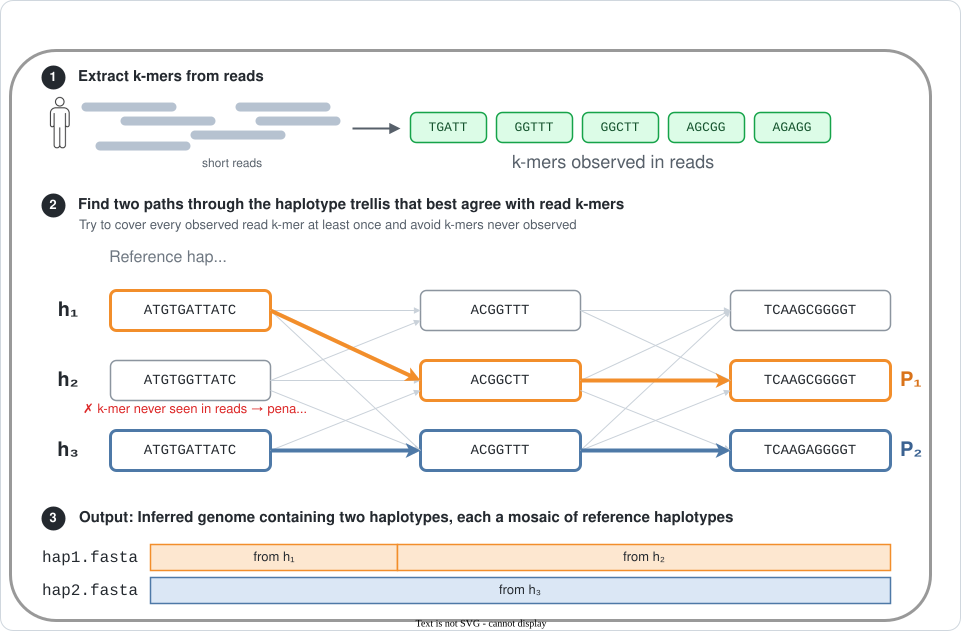

# DiGi
DiGi is a pangenome-based genome inference method. It is useful for genotyping and phasing variants in the human [major histocompatibility complex (MHC)](https://genome.ucsc.edu/cgi-bin/hgc?db=hg38&c=chr6&l=31944158&r=31944159&o=28510019&t=33480577&g=comments&i=MHC). Given a pangenome graph of MHC reference haplotypes (e.g., from haplotype-resolved long-read assemblies) and short reads of a donor genome, DiGi infers two mosaic paths in the pangenome that best explain the reads. It outputs two FASTA files, one per inferred haplotype. These can be passed to variant-calling tools such as [PAV](https://github.com/EichlerLab/pav) or gene-annotation tools such as [Immuannot](https://github.com/YingZhou001/Immuannot) for downstream analysis.

> Note: DiGi needs a Gurobi license to solve its integer program. Free academic licenses are available at [gurobi.com/academics](https://www.gurobi.com/academics).

> Note: Phasing is reliable within genes but may contain switch errors over long distances, so the two output haplotypes should not be assumed to be phased across the full MHC.

## Installation
Requires Linux (x86-64) and GCC 8.3 or newer.

### STEP 1: Download source code and compile
```bash
git clone https://github.com/at-cg/DiGi.git
cd DiGi
make
```

`make` also downloads the external dependencies: [KMC](https://github.com/refresh-bio/KMC) and Gurobi

### STEP 2: Gurobi license setup 
DiGi reads your Gurobi license from the `GRB_LICENSE_FILE` environment variable. For academic use, a **WLS Academic** license works well and is easy to set up:

1. Register or log in at the [Gurobi Academic Program](https://www.gurobi.com/academics) with your institutional email address and request a **WLS Academic** license.
2. Open the [Gurobi Web License Manager](https://license.gurobi.com/manager/licenses).
3. Go to **API Keys** and create an API key for your WLS Academic license.
4. Download the generated `gurobi.lic` file.
5. Point DiGi to it by using the following command:

```bash
export GRB_LICENSE_FILE=/path/to/gurobi.lic
```

To avoid running this command in every new session, add it to your `~/.bashrc`.


## General usage
DiGi takes paired-end short reads and an MHC pangenome graph as input:

```bash
bash scripts/infer_haplotypes.sh -r1 read1.fq -r2 read2.fq -g <graph_dir> -outdir <out_dir> -outname <prefix> 
```

`read1.fq` and `read2.fq` should contain paired-end reads filtered to the MHC region. After a successful run, DiGi writes `<prefix>_hap1.fa` and `<prefix>_hap2.fa` to `<out_dir>`.

A pre-built MHC pangenome graph of 54 individuals (108 haplotypes) is available on [Zenodo](https://zenodo.org/records/23974110). Download and extract the archive, then pass the extracted folder to `-g` as `<graph_dir>`.

## Try DiGi on small data

This example infers the MHC haplotypes of HG002 genome using a small graph. This run should take about five minutes.

```bash
# From the DiGi project folder
# Download the small graph
wget https://github.com/at-cg/DiGi/releases/download/v0.1/graph_18_haps.tar.gz
tar -xzvf graph_18_haps.tar.gz

# Run inference
bash scripts/infer_haplotypes.sh \
  -r1 example/data/HG002.MHC_R1.10x.fastq.gz \
  -r2 example/data/HG002.MHC_R2.10x.fastq.gz \
  -g graph_18_haps -outdir DiGi_TestRun -outname HG002
```

When the run finishes, the two inferred haplotypes are in `DiGi_TestRun/HG002_hap1.fa` and `DiGi_TestRun/HG002_hap2.fa`. The folder also holds the solver logs and, under `reads/`, intermediate read k-mers, which you can ignore.

## Algorithm overview

DiGi formulates diploid genome inference as an integer quadratic program (IQP) that jointly reconstructs two haplotypes as mosaic paths through the pangenome graph. The optimization balances agreement between the inferred haplotypes and observed read $k$-mers while limiting recombinations between reference haplotypes.

<p align="center">
  
</p>
